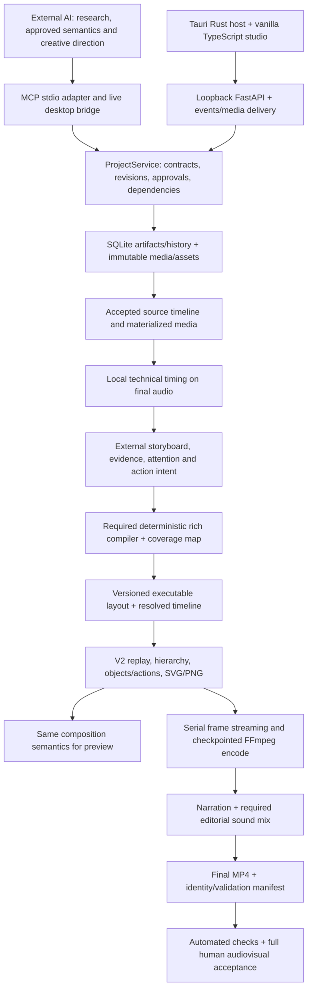

# ATME master execution blueprint

Audit date: 2026-10-12 (Africa/Lagos). Originally delivered as a proposed handoff. **Owner approved this implementation handoff on 2026-10-13, subject to the four conditions in the active goal: preserve the approved phase order and work, retain the existing reviewer/settings, verify at defined boundaries, and maintain the fixed Phase 3 ledger.** The audit-only hold is lifted; original product, phase and review gates remain in force.

Read alongside [requirements](ATME_REQUIREMENTS_TRACEABILITY.md), [visual audit](ATME_VISUAL_AND_RENDER_AUDIT.md), [workflow audit](ATME_AGENT_AND_WORKFLOW_AUDIT.md), and [owner report](ATME_AUDIT_EXECUTIVE_REPORT.md). Existing approved requirements, phase gates and the finite Phase 3 ledger remain authoritative. This blueprint consolidates execution; it does not restart ATME or replace its architecture.

## A. Executive findings

ATME is an existing Tauri/vanilla TypeScript studio with a substantial Python project/media engine, revisioned SQLite state, genuine MCP, a working bounded legacy renderer and an unfinished richer v2 visual runtime. Preserve it. The main obstacle is the missing path from rich authored meaning to validated public v2 composition and a complete inspected video, not absence of all infrastructure.

Fresh audit evidence: TypeScript passes; 275 selected main-source cases have passing evidence across the initial run and targeted short-path rerun; 115 isolated Split identity/contract cases pass. The initial run actually recorded **265 passed/10 failed**, and all **13** cases in the three affected files passed after changing only disposable output location. This is **not** a fresh 275-pass single run or the full 1,658-test suite. Ten initial failures expose a repeatable long-path boundary at 260–261 characters. Two real short offline MP4s decode successfully in landscape/portrait; acoustic alignment is mocked, so they do not establish speech accuracy.

Main source is unchanged from frozen `fc480037`; the preserved full log's hash matches its historical **1,653 passed/5 skipped**, 4,279.28-second run. Five directory-symlink protections remain skipped, not passed. The unresolved native XML/raster and execute-access-violation incidents remain relevant despite later green runs. Broad Ruff reports 202 findings, while recent progress claims were scoped checks. Do not conflate those scopes.

The public capability is explicitly `v2_renderer_available=False`, and the runner rejects v2 preview/render. Rich compiler, fallback containment, full production validation, complete sound, public/installed parity and a premium full-video corpus are incomplete. Two inspected real project databases record no completed project render runs. This is evidence for those databases only, not proof that nobody has ever exported elsewhere.

Historical reported progress is **23.7%, unconfirmed**. Recomputed current Phase 3 engineering credit is **2150/7900 = 27.2%**, using the established fixed 79-row weighting; final accepted count is **0/79**. Full-product verified completion cannot be quantified from an absent product-level weighting. Production readiness: **not demonstrated**.

## B. Architecture and dependency map

The legacy v1 route already connects project inputs, alignment, layered SVG and MP4 for bounded cases. `board_compiler.py` provides validated assignment/timing; `ProjectRunner.compile` snapshots selected artifacts and media. Neither is the required full semantic compiler. V2 frame mechanics and private stored-project probes exist below the unimplemented public admission boundary.

Stack: Tauri 2/Rust, TypeScript 5/Vite 5/vanilla TS, Python >=3.12, Pydantic, FastAPI/Uvicorn, MCP 2.2.0, SQLite, resvg/Pillow/NumPy, local speech/audio libraries and FFmpeg. Audio/align/render are optional dependency groups; native production dependency locking remains unresolved. No repository `.github` CI directory was found. Do not add a React, Remotion, Manim or cloud rendering migration to solve these gaps.

Critical path under existing approvals: finish bounded Split/current Phase 3 runtime matrix → native reliability and public renderer parity → semantic compiler/fallback containment → evidence/continuity/attention/sound/quality gates → MCP/studio integration → format/cache/performance → packaged full production acceptance. Dependency work may be scheduled efficiently, but phase exits cannot be silently skipped.

## C. Prioritized issue register

Severity refers to production delivery, not security scoring. Each row preserves uncertainties instead of inventing root causes.

| ID / severity | Evidence, subsystem and affected files | Cause / uncertainty | Corrective action, dependency and acceptance |
|---|---|---|---|
| AUD-01 Critical | R-03/04/06; E02/E05. `board_compiler.py`, `project_runner.py`, `render/autolayout.py`; installed project 3 | Confirmed architectural gap: assignment/snapshotting is narrower than rich semantic compilation. 35 assets/27 actions historically became 16 boxes/text; layout 7 still has 9 rectangles/7 texts. | After Phase 3, implement deterministic composition/coverage and blocking fallback policy. Every instruction has an executed/degraded/rejected record and source location; unsupported intent cannot validate as production-ready. Verify rich-storyboard goldens and negative silent-loss fixtures. |
| AUD-02 Critical | R-15/P3-44; E05. `ProjectService.capabilities`, runner `_require_legacy_runtime` boundary and private v2 frame route | Public v2 unavailable by deliberate gate, not an accidental advertised feature. | Complete P3 admission dependencies; unify preview/export composition and prove both authored profiles, random seek and exact revisions. Do not simply flip the capability flag. |
| AUD-03 High | P3-46; E07. native raster/Pydantic process boundary, `v2_svg.py`, `v2_raster.py`, environment | Historical U+000F SVG raster failure and Windows 0xC0000005 confirmed in logs/reports; faulting component/root cause unresolved. | Preserve failing exact bytes, exception/dump and binary/package hashes. Reproduce in isolated native worker with bounded diagnostics. A fix requires a causal regression and frozen integration; inability to reproduce remains unresolved, not closed by reruns. No dependency upgrade without approval. |
| AUD-04 High | P3/Split plan; E02/E08. `contracts_v2.py`, `v2_split_identity.py` in worktree, replay/paint adapters | Task 2 partial despite 115 passing tests; broader family/evidence/receipt obligations remain. Main lacks isolated Split changes. | Resume exact Task 2; satisfy remaining identity tests and existing auditor. Then tasks 3–11 and all underlying required family dependencies. Use origin guard; no partial public admission. |
| AUD-05 High | R-01/02/07/10; ledger P3-24–40 and Split family rows | Required primitives and sound-event ledger are absent/declarations only, not just undocumented. | Deliver finite rows without generic fallbacks: parts/lists, charts, code/callouts, richer technical/character assets, pointers, media, clips/effects/instances. Per row: strict input, actual pixels, unsupported rejection, deterministic seek and authored-profile proof. |
| AUD-06 High | R-08/09/11; evidence/return/attention runtime and future compiler | Mechanical state is strong; complete narrative choreography and evidence golden absent. | After compiler, build claim→readable evidence→annotated/developed return and causal full narrative. Validate provenance, holds, stable identity and no resurrection; inspect original full explanation. |
| AUD-07 High | R-14; SoundAction, audio/pipeline | Narration processing exists; editorial sound runtime not found. | Phase 3 event ledger then Phase 7 deterministic mixing with original/cleared sound assets, fades, priority and silence. Verify cue timing, clipping/loudness and intelligibility without paid calls. |
| AUD-08 High | R-15, E09/E10. No current rich packaged production; V001 is Fusion and playback unverified | Release evidence missing; separate proof cannot substitute for ATME acceptance. | Render complete approved recorded long-form via MCP/studio; targeted correction; offline reopen/resume; packaged golden corpus and >=16/20/no-hard-fail review. |
| AUD-09 High | E06 fresh tests. `project_runner.py:compile`, `project_timing.py:_snapshot` | 10 writes fail at 260–261-character destination paths; same affected suites pass in shorter root. Environment/path interaction strongly isolated; exact Win32 manifest/long-path policy not yet diagnosed. | Add a localized path-budget/long-path strategy and actionable preflight without changing global Windows policy. Acceptance: long custom data root + short root compile/timing/render succeed or fail early with clear supported-path guidance; no partial published run. Owner chooses portability contract if necessary. |
| AUD-10 Medium | E06: 202 Ruff findings; pyproject, source/tests | Broad check differs from historical scoped checks; many formatting/modernization findings, plus unused/redefined names. Not proof of 202 behavior bugs. | Pin/document agreed lint scope/config with source/version; resolve functional findings first, fix nearby style as touched, avoid unrelated rewrite. Acceptance: agreed check passes or explicitly recorded baseline; no changed behavior from cleanup. |
| AUD-11 Medium | E03/E04. ~1 GB history, duplicated status, reviewer interruptions | Reconstruction/review overhead evidenced; no reliable accounting of exact waste fraction. | One authoritative ledger, task-local checkpoint, bounded immutable review packets and risk-based regression selection. Approval required for changing existing reviewer gates/model settings. Verify a restart finds next task without full scan. |
| AUD-12 High | R-15/Phase 11–12; E01/E07. dirty packaged binaries, five skipped symlink tests, missing dense/long budget | Current source/package identity and adversarial redirected-file protection not fully certified. | Preserve artifacts; later build exact source in explicit environment, run skipped protections with supported permissions or obtain explicit disposition, benchmark dense/long workloads and package lifecycle/offline render. Do not install during audit. |
| AUD-13 Medium | E10: both fresh final test MP4s have 2.966667 s video vs 3.000000 s audio; pre-mux video 3.4 s | Measured one-frame stream-end difference; no demonstrated speech-onset drift or audible truncation. Exact mux/packet-boundary cause and intended tolerance not established. | Specify end coverage/tail policy against final PCM/frame grid; add ffprobe/decode assertions at fractional/exact-frame lengths and multi-segment joins. Accept only documented tolerance with no lost final speech or unintended final-state cutoff. |
| AUD-14 Medium | A-01/V4 cleanup. `agents/`, `gateway/`, prompts, old cognitive entrypoints/tests | Retired internal creative source remains by migration staging; no evidence of current production provider use. | After replacement acceptance, remove obsolete production entrypoints/dependencies while preserving deterministic helpers, migration reads and regression coverage. Verify zero-key install and no internal provider route. |

## D. Bounded implementation milestones

All milestones require: preserve external semantic authority, immutable originals, revision checks, final-cleaned timing, original Paper & Ink assets, CPU-first renderer, both approved profiles and truthful capabilities. No new dependencies/architecture changes without the applicable owner decision. Acceptance evidence must include source identity, command, exit and limitations. Existing approved plans prevail over shorthand below.

### M1 — Finish the current Split identity task (next executable work)

- **Inputs:** current ledger; approved Split spec and eleven-task plan; existing isolated worktree HEAD `cb8c9739...` plus dirty Task 2 files; main baseline `fc480037`; task-2 brief/progress.
- **Exact scope/files:** `render/v2_split_identity.py`, Split receipt models in `store/contracts_v2.py`, `test_v2_split_identity.py`, relevant fixtures and two action-bearing schemas. Finish compound/family content projection, independent asset/evidence byte attestation, style/registry identity, canonical basis/policy/completion boundaries, child-version rejection and resolved-only receipt serialization. Retain the reviewed local/effective visibility distinction and removed source reveal=0.
- **Constraints/dependencies:** use existing worktree; main environment supplies dependencies only; origin guard required. Do not enable Split painting or implement later capture/history duties as if Task 2 required them. Preserve bare legacy hash and immutable records.
- **Acceptance:** approved identity/contract suite plus named Count/Morph/Group receipt regressions; false-but-rehashed packets reject; pose-only content identity remains stable; compound ordering affects the right identity; unknown payload rejects. Schema generation repeatability and inspected diff; bounded existing-auditor review.
- **Completion/gate:** mark Task 2 only, with exact evidence. Owner approval of this handoff precedes work; existing reviewer gate remains. 115 fresh passes are a starting checkpoint, not completion.

### M2 — Complete Split and the finite Phase 3 capability dependencies

- **Inputs:** accepted M1, exact existing tasks 3–11 and P3/S3 rows; original registry/fonts; both authored profiles.
- **Scope:** execute tasks 3 reference closure, 4 captured history/basis, 5 state/versions, 6 paint registry, 7 eight family adapters, 8 evidence windows, 9 stored/duplicate/return history, 10 family/profile/offline proof, 11 integration/admission preparation. Implement underlying missing primitive rows once and reference them from Split; no double-counted implementation.
- **Files/subsystems:** `contracts_v2.py`, replay/hierarchy/state/paint modules, project service/asset/history paths, named Split tests; P3-24–40 families and P3-25 event ledger. New modules only where approved plan names a real responsibility.
- **Acceptance:** every declared supported family has actual paint plus target-specific pixel assertions, exact lifecycle/versions, bounds/anchors, invalid input tests, stored duplication/return coverage and sequential/random-seek equivalence. Sound ledger proves events, not audible mixing. Run each existing task's named commands; broad integration once at the defined boundary.
- **Completion/gate:** all task obligations and applicable capability evidence, not “one example works.” Existing auditor per approved task and final plan/matrix audit. No replacement reviewer to bypass usage limits, no denominator expansion without owner decision.

### M3 — Close native reliability, path robustness and Phase 3 public parity

- **Inputs:** M2 runtime matrix, original native failure artifacts, exact dependency/binary identities, short/long data-root reproductions.
- **Scope/files:** native raster boundary and deterministic replay; runner/timing path handling; public renderer preview/export boundary; finite P3-41–47 gates. AUD-03/09/12/13 must receive truthful dispositions.
- **Acceptance:** reproduce/fix native failure with causal evidence or explicitly present unresolved reliability decision; short and long path regressions; same exact v2 composition in preview/export; both authored profiles, negative unsupported matrix, offline render, dense bounded benchmark, complete frozen suite and disposition of skipped protections. Inspect actual pixels and end coverage. Do not change creative semantics to obtain a green test.
- **Completion/gate:** independent final Phase 3 acceptance against all 79 rows. No public capability flip until admission evidence is complete. Later installed/human gates remain later; native uncertainty cannot be buried in a pass count.

### M4 — Build the rich deterministic compiler and fallback gate (Phase 4)

- **Inputs:** admitted v2 vocabulary, externally authored semantic plan, accepted timing/asset snapshots, approved style and profiles.
- **Scope/files:** extend deterministic `board_compiler.py`/runner boundary through a normalized IR and instruction coverage; preserve source IDs, evidence, actions, attention, continuity, timing and aspect intent. Add localized compiler modules when needed; no internal model or generic template rewrite.
- **Acceptance:** rich golden fixture with each instruction traced into concrete objects/actions or explicit diagnostic; unsupported instruction and fallback-only output block production; repeated inputs produce identical resolved artifacts; stale authority/timing rejects; both independently composed profiles.
- **Completion/gate:** Phase 4 exit and independent audit. Any schema/public contract change follows migration/versioning review. A compiler cannot self-approve creative quality.

### M5 — Complete evidence, continuity and attention (Phases 5–6)

- **Inputs:** M4 coverage and actual recording; original provenance-aware evidence assets.
- **Scope/files:** evidence/annotation/return runtime, compiler choreography, project assets and validation. Complete claim linking, permitted crops/apertures, source labels, readable holds, developed abstraction returns; stable-board reasons, transient context/focus, reading/listening states, opening-to-ending payoff.
- **Acceptance:** evidence-led and abstraction-only complete narrative fixtures; no wrong target, fabricated source, resurrected object or unreasoned scene-per-board output. Quantitative geometry/timing tests plus human explanation/readability review. Sponsor remains optional.
- **Completion/gate:** separate Phase 5 and 6 exit evidence even if code is shared; actual rendered artifacts required. Owner supplies/approves creative narrative and factual content.

### M6 — Add deterministic editorial sound (Phase 7)

- **Inputs:** accepted sound-event ledger, final cleaned narration and cleared local audio assets.
- **Scope/files:** audio/assembly pipeline and canonical event timeline: SFX, music state, silence, fades, gain, loops and narration priority. Preserve recording authority and exact timing.
- **Acceptance:** offline sample-level cue placement, duration and fade tests; no clipping; declared loudness/intelligibility checks and normal-speed listening. No undeclared semantic sound decisions or paid service calls.
- **Completion/gate:** Phase 7 audible output acceptance; music is not mandatory in every video, but supported sound semantics cannot be claimed from a schema alone.

### M7 — Enforce production-quality validation (Phase 8)

- **Inputs:** M4–6 full production artifacts and coverage records; existing quality rubric.
- **Scope:** structured error/warning/human-review codes with scene/action locations for coverage, fallback, legibility/safe areas, density, timing/pacing, evidence, camera purpose, continuity, audio and narrative resolution.
- **Acceptance:** negative fixtures independently demonstrate each hard gate; known sparse/slideshow semantic-loss example cannot receive production-ready status; human score >=16/20 and no hard failure on representative original output.
- **Completion/gate:** Phase 8 independent/human review. Fix content through bounded artifact revisions, not source-code exceptions for one video.

### M8 — Expose the finished workflow through MCP and studio (Phases 9–10)

- **Inputs:** verified compiler/runtime/quality contracts; supported local AI client; isolated user-style project.
- **Scope/files:** `mcp_server.py`, `mcp_runtime.py`, server project/proposal routes, `studio.ts`, board editor/proposal UI and Rust host integration. Versioned grammar/resources/examples, truthful capabilities, live artifact updates, source/asset viewing, contextual validation and selected-range corrections; manual and AI render parity.
- **Acceptance:** actual MCP client creates/reads/writes with conflict handling, receives invalid-input diagnostics and corrects them; user applies bounded proposal; same saved revision previews/renders; media remains playable while menus/navigation operate; exact client identity shown only when supplied. Test keyboard interactions and source/timeline edits in actual UI.
- **Completion/gate:** distinct Phase 9/10 exits; no raw implementation internals in normal user flow. Existing script approval and revision acceptance remain user-controlled.

### M9 — Validate recomposition, caches and production performance (Phase 11)

- **Inputs:** complete long-form and portrait projects, dense evidence/illustration scene, target machine.
- **Scope:** semantic portrait recomposition, dependency-bound invalidation, bounded memory/cache, long-project preview and render budgets, interrupted-segment recovery.
- **Acceptance:** portrait re-lays out meaning rather than cropping; edits invalidate every dependent artifact and no unrelated source; full measured durations, peak memory, disk, cold/warm preview and bake rates. Record agreed budget before claiming pass; legacy small-fixture speed is not the target.
- **Completion/gate:** Phase 11 approval; new budget/scope tradeoffs require owner acceptance. Retain both profiles even if a landscape pilot is prioritized.

### M10 — Package, migrate and accept production (Phase 12 plus gated V4 cleanup)

- **Inputs:** accepted prior phase gates; frozen code/dependencies; backed-up project copies; approved real narration/script and reference corpus.
- **Scope:** non-destructive v1 migration/rollback, exact source-to-package build identity, zero-key startup, process lifecycle/uninstall behavior, actual full golden corpus. Retire obsolete cognitive entrypoints only after replacement acceptance.
- **Acceptance:** script+recording, recording-only, presenter, abstraction, evidence, optional/no sponsor, targeted manual/AI correction, both profiles, migrated project, network-isolated reopen/preview/render/resume; full MP4 decode/streams/timing and human >=16/20; no unresolved Critical/High release issue.
- **Completion/gate:** owner final release approval after actual installed workflow and watched/listened output. No automatic deployment/install or release statement from unit tests.

## E. Reusable Sol 6.1 implementation protocol

1. Read this blueprint's current handoff and the **existing ledger's latest checkpoint**. Verify worktree/HEAD/dirty files and owner approval. Do not reset or overwrite incomplete Split work.
2. Select the next approved unblocked task, currently M1/Task 2. Read only its brief, required spec clauses, changed modules, fixtures and named tests. Expand only for a demonstrated dependency.
3. Preserve strict contracts, canonical identities, old records, timing authority and phase boundaries. Implement only task scope. Record any genuine authority conflict; do not silently choose.
4. Run specified tests in a short disposable directory. For the isolated worktree, enforce origin checks before/after collection and for child clients; main venv is dependencies only.
5. Keep command, cwd, environment profile, source/hash identity, exit code, summary, skipped cases and rendered artifact hashes. An interrupted log or passing mock does not prove the missing real component.
6. Obtain the required bounded independent review. Submit diff, relevant requirement clauses, failing/passing evidence and exact question once. Do not label self-review independent; do not replace a capacity-limited reviewer against approved policy.
7. Update only the existing ledger/current task checkpoint, referencing detailed evidence once. A schema or test count does not raise acceptance automatically. No new denominator/scope without owner decision.
8. Advance to the next approved task. Run a full suite at its required integration boundary, not repeatedly on an unchanged revision.
9. After two distinct failed repair hypotheses, provide a targeted escalation packet: observed failure, exact reproducer/bytes, expected contract, tried hypotheses and smallest uncertain boundary. Astra Medium is appropriate for native/sync/architecture issues; do not redesign wholesale.
10. Stop for owner-required product/phase/schema tradeoffs, new dependencies/paid calls, waived requirements or changed review policy. The current audit's final approval is a prerequisite, not permission to bypass later gates.

## F. Model routing

Current local cache/runtime supports exact IDs `gpt-6.1-sol` and `gpt-6-astra` with Low/Medium. Proposed default: Sol Medium for inline implementation/coordination; Sol Low for inexpensive evidence triage; Astra Low for targeted critical reviews; Astra Medium for difficult native renderer/synchronization/architecture failures. Use one main worker and the existing independent reviewer. No additional persistent test/report agents. Changing the existing review model or schedule requires owner approval; no configuration was changed here. Capacity availability is not guaranteed by compatibility metadata.

## G. Restart recovery and current handoff

Do not create a competing checkpoint database. The current task truth is `ATME_VISUAL_PIPELINE_PHASE_3_LEDGER.md`; execution detail is the isolated `.superpowers/sdd/2026-10-09-authored-visual-split/` directory.

| Field | Current audit handoff |
|---|---|
| Active product task | Split Task 2, identities/completion receipts; partial |
| Main HEAD/source | `ce939f3` docs / `fc480037` product source |
| Worktree | `C:/Users/USER/.codex/worktrees/phase3-return-receipts/Movie engine`, HEAD `cb8c9739...`, unfinished dirty/untracked Task 2 files |
| Last accepted bounded task | Split Task 1 at `5183cb6`, historical 226 tests + independent bounded PASS |
| Fresh Task 2 evidence | 115 identity/contract tests passed, exact isolated origins verified; full Task 2 obligations not done |
| Pending work | Compound/family/evidence/style/asset identities and broader receipt tests; required Count/Morph/Group regressions and final bounded review |
| Blockers | Native reliability unresolved for production; usage-limited old goal; review gates; audit handoff approval |
| Next executable step after approval | Verify unchanged worktree, read existing task-2 brief and named approved Task 2 acceptance list, complete missing tests/implementation inline |

Recommended compact checkpoint fields: task/row, authority, HEAD+dirty paths, last verified command/exit/log/hash, active worker identity if any, blocker, pending approval/review, next exact action. Keep current status at the top; historical notes below. Do not mutate Codex SQLite databases. No goal resumed in this audit.

## H. Verification inventory and release gates

| Check | Audit execution/result | Limits |
|---|---|---|
| TypeScript `node app/node_modules/typescript/bin/tsc --noEmit` (cwd app) | PASS, exit 0 | Typecheck only, no interactive desktop proof |
| Ruff `check --no-cache src tests` (cwd sidecar) | FAIL, 202 findings; log/settings retained | Broad scope; not comparable to earlier scoped PASS. No auto-fix |
| 19-file focused Python selection | 265 PASS, 10 FAIL, 614.83 s pytest time, exit 1 | Failures at long pending-path writes; preserved verbatim |
| Affected runner/timing/offline files in short root | 13 PASS, 95.35 s, exit 0 | Same source/environment except output root; this overlaps three initial passes |
| Isolated Split identity+contract | 115 PASS, 7.29 s, exit 0 | Origin guarded; does not complete Task 2 or whole Split |
| Historical full suite | Existing log hash independently verified: 1,653 PASS/5 skipped, 4,279.28 s | Not rerun; product source comparison to `fc480037` empty; no claim on isolated Split |
| Real offline MP4 outputs | Both profiles decode exit 0; 1280×720 and 720×1280, 30 fps, AAC/H.264 | 3-second synthetic tone, mocked acoustic timing/denoise; Python socket denial only |
| Output duration inspection | Both video streams 2.966667 s, audio 3.0 s; pre-mux video 3.4 s | One-frame end difference; investigate policy, not asserted perceptual desync |
| V001 hash/WAV verification | Five hashes match; exact 744,000-sample prefix | Separate Fusion handoff; native playback absent |
| Legacy video | Fresh ffprobe/contact sheet | Failure example, not premium acceptance |
| Source preservation | 254 initial protected-file hashes unchanged at audit check | Existing dirty packaging preserved; final verification recorded separately |

Not executed: full 1,658-test rerun (71-minute historical cost, no product changes); Rust/Vite/package rebuild or installer/uninstall (audit forbids rebuilding/mutating installed state); full live UI/keyboard/playback smoke; complete actual-narration ASR/perceptual sync and loudness review; dense/long-form performance/soak and kill/resume; symlink cases requiring a different Windows permission setup; paid provider/Jev calls; new model/dependency downloads; schema regeneration that would write tracked files. Existing tests are inventoried by `inventory.json`; no fresh evidence is claimed for omitted tests. Python mypy was not run: no established configured target/acceptance evidence was identified, whereas the actual project checks are pytest/Ruff/TS and native host checks.

Release gates are conjunctive: exact approved narrative and cleaned timing → complete intent coverage → actual rich motion → reliable original narration synchronization → full landscape video → bounded correction → offline resumable export → installed identity/lifecycle → all required corpus/profile/migration tests → >=16/20 human review/no hard failure. No count of passed tests substitutes for these gates.

## I. Risks and owner decisions

- Approve this implementation handoff and proposed routing/efficiency changes; do not assume the old goal authorizes automatic action from this audit.
- Decide whether to retain the existing strict phase order (recommended default because already approved) or explicitly authorize an earlier **limited landscape production pilot**. A pilot would need a named dependency subset, unchanged acceptance on its admitted capabilities and retained later obligations; it would not count as Phase 3 or full product completion. No scope reduction is implemented/proposed as already approved.
- Select/approve the complete real-narration acceptance project. V001 is a short separately gated Fusion proof; neither full Fusion generation nor migration of its pipeline is authorized here.
- Native fault disposition, path portability contract, output end tolerance and dense/long performance budgets require explicit evidence/decision before release. Do not promise a delivery date without task throughput and accepted runtime scope.
- Five skipped symlink protections, full interactive UI, installed build parity, actual ASR confidence and human audiovisual quality remain uncertainties. No failure is inferred solely from unavailable verification.

## Evidence register

Audit evidence directory: `docs/audit-evidence/2026-10-12/`. It is a read-only audit record after delivery, **not a second implementation progress ledger**.

| ID | Evidence and scope |
|---|---|
| E01 | `inventory.json`, `initial-tracked-status.txt`, `initial-source-hashes.json`; Git HEAD/worktree readout. Existing package/build differences predate audit. |
| E02 | Approved V4/rebuild/traceability/Phase 3 ledger, Split spec/plan and progress; original plan/ADRs, external locked v2 spec and research packets. Current 79-row arithmetic independently recomputed. |
| E03 | `agent-inventory.json`, sanitized `all-project-thread-metadata.json`, `goal-snapshot.json`; Codex runtime snapshots of main idle and auditor notLoaded. Local config/cache read; no secret values copied. |
| E04 | Main rollout one-pass statistics, `historical-23-7-excerpts.json` (no exact percentage matches); existing Split task brief/progress. Raw timestamp matches are not percentage evidence. |
| E05 | `project-db-inventory.json`, `project-state-readonly.json`; read-only SQLite queries; `ProjectService.capabilities`, runner v2 gate, compiler source. Two real databases, zero recorded project render runs. |
| E06 | `test-command.json`, `fresh-focused-tests.log`, result JSON; `short-path-command.json`, short-path tests/result; `typescript.log`, `ruff.log`, `ruff-settings.log`. |
| E07 | `sidecar/test-artifacts/native-main-count-full/child.log`, verified SHA256 `A94D1CEA2366C2373CFED20199A0A87575C1D20E66F4FBAA6E7AC1477F6B1728`; Count progress records 12/13/33 describe failure/clean-run scope. |
| E08 | `isolated-split-tests.log`, `isolated-split-result.json`; origin guard before/after collection. Main source never imported as isolated implementation. |
| E09 | `proof-independent-checks.json`; V001 manifest/r03 report/native `.comp` and layout-only sheet; `legacy-video-probe.json`, `legacy-contact.png`; research packet notes and PDF extraction. |
| E10 | `fresh-offline-output-probes.json`, `fresh-decode-results.json`, `fresh-offline-contact.png`; disposable real renders under `C:/Users/USER/atmea-kpmbhvni/`. |

Several evidence-discovery scripts encountered Windows console-encoding errors **after saving their files**; affected ZIP/model-cache/PDF reads were completed through UTF-8-safe reads. These are audit tooling errors, not ATME runtime failures. No application source, agent configuration, runtime setting, original media or project data was changed. Tests wrote only isolated disposable outputs and their normal local subprocess state; no paid services, commits, merges, deployments or dependency installations were performed.
